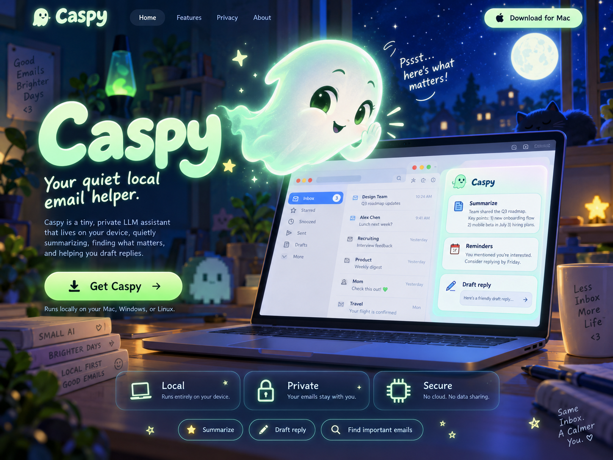

# ghost-box



Caspy has a small model-selection sidebar. Select the Qwen3.5 MLX or GGUF Q4_K_M preset and click **Download preset**, or choose a local MLX folder/GGUF file. Selection persists in Qt settings. Downloading does not load a model. Local MLX and llama.cpp inference answer questions and summarize explicitly selected emails in a separate process, with bounded batching for large selections.

A lightweight desktop email assistant powered by **Caspy**, your local small language model companion, with on-device inference via MLX and llama.cpp.

Ghost-box helps you summarize email conversations, search downloaded messages, and ask questions with references to the original mail. It is designed for macOS and Windows, with a small Python codebase that is straightforward to read, review, and maintain.

> **Status: local Q&A and summarization.** Gmail and Outlook adapters, RAM-only emails, model downloads/selection, MLX and local GGUF inference, batch-task progress, memory reporting, and JSON generation profiles are implemented. Synthetic offline and UI checks passed on Apple Silicon. Literal inbox search, RAM cleanup controls and fetch coverage are implemented; broader quality evaluations, live Microsoft sign-in/delivery checks, native Windows validation, and packaging remain planned.

## Purpose

Reduce the time spent reading and finding email while keeping AI processing on the user's device. The first release should complete one useful workflow:

1. Connect a mail account.
2. Click **Fetch** to download messages within a selected date range.
3. Open a message or conversation and request a summary.
4. Search downloaded mail or ask a question.
5. Follow the answer's references back to the supporting messages.
6. Reuse a loaded model for follow-ups; unload manually or let the five-minute idle timer release it.

## Design principles

- **Small enough to understand.** Prefer explicit application code, few dependencies, and a narrow feature set.
- **Local AI processing.** Run inference and search on the device. Do not send mail content to a hosted model.
- **User-controlled fetching.** Retrieve mail only when requested; no background mailbox synchronization in the first release.
- **Read-only fetching by default.** Sending is a separate opt-in capability used only after an explicit recipient/body review and confirmation. No provider deletion or automatic sending.
- **Responsive by default.** Keep mail fetching, downloads, indexing, and inference off the UI thread.
- **Resource-aware operation.** Start the model when needed and release its process after an idle timeout.
- **Verifiable answers.** Show supporting messages and make incomplete search coverage visible.

## Initial scope

| Area | Planned behavior |
| --- | --- |
| Platforms | macOS on Apple Silicon and Windows; inference support depends on the selected backend and hardware |
| Interface | One desktop window with a mail list, message view, and summary/question panel |
| Accounts | One active provider/account at a time; Gmail and Outlook have separate saved credentials |
| Fetching | Manual fetch with a selected date range and visible progress, cancellation, and errors |
| Summaries | Summarize a selected message or conversation, preserving decisions, requests, and stated deadlines |
| Search | Local keyword and exact-text search, with sender, date, and subject filters |
| Questions | Answer from retrieved messages and reference the supporting source text |
| Models | A tested default model download and an option to select an existing local model |
| Storage | RAM-only email and derived results; no email database or disk cache |
| Cleanup | Remove downloaded mail and derived local data through an explicit user action |

The application must distinguish **no supporting message found** from **no such message exists**. Answers should state the relevant local search coverage, including the downloaded date range and the last successful fetch.

## Proposed implementation

The starting stack is **Python and PySide6 (Qt Widgets)**. A simple desktop interface avoids the need for a browser engine, JavaScript frontend, or local web server.

| Component | Responsibility |
| --- | --- |
| PySide6 interface | Display messages, accept questions, and show operation and model status |
| Python application core | Coordinate fetching, storage, retrieval, and inference |
| Python in-memory store | Hold fetched mail only for the current session |
| Mail connectors | Authenticate with the provider and fetch through read-only APIs; send only approved MIME payloads with a separate grant |
| Model worker | Load a local model and stream generated output in a separate process |

Mail fetching and model downloads run in background workers. Inference runs in a separate process so the UI remains responsive and the application can release model memory by stopping the worker. Keep communication between the application and worker small and explicit.

Python is the initial implementation choice. Introduce another application language only if measurements reveal a concrete limitation. Measure packaged application size, idle memory, and model memory separately.

### Inference backends

| Backend | Platform | Model input |
| --- | --- | --- |
| MLX | macOS on Apple Silicon | Compatible local MLX model directory |
| llama.cpp | macOS and Windows | Compatible local GGUF file |

The user selects the backend explicitly. A file format alone does not establish model compatibility. Complete one backend first, then add the second behind the same narrow inference interface.

The initial model preset is [mlx-community/Qwen3.5-4B-MLX-4bit](https://huggingface.co/mlx-community/Qwen3.5-4B-MLX-4bit). Text-only generation was verified with the pinned `mlx-lm==0.32.2` runtime and this preset revision. [Occam-Turkish](https://huggingface.co/cbarkinozer/Qwen3.5-4B-Turkish-Concise-Lora) is also built into the Caspy model list as a merged Q4_K_M GGUF (~2.7 GB), with a pinned revision and SHA-256-verified download. It targets concise Turkish responses; email-workflow accuracy evaluation remains pending. Its starting settings use temperature 0 and repetition penalty 1.05. Select it and click **Download preset**; model weights are not bundled or downloaded automatically. Caspy is the companion's name; the underlying model can change.

Choose the default using email summarization and question-answering results, including factual faithfulness, retrieval quality, latency, and memory usage. Concise output alone is insufficient.

### Model lifecycle

Expose a small set of understandable states: **not configured**, **downloading**, **unloaded**, **loading**, **ready**, **generating**, and **error**.

- Show download progress and support cancellation and retry.
- Validate the configured model before starting inference.
- Load on the first inference request, independently of mail fetching.
- Keep one model worker warm between requests; unload manually or after five idle minutes.
- Never unload during an active generation; let the user cancel it first.
- Surface failures without freezing the interface or repeatedly restarting the worker.

## Retrieval and answers

Use a bounded, predictable workflow:

```text
Question → validated filters → local search → selected source messages → answer with references
```

Begin with in-memory text search and metadata filters. Do not introduce an embedding model or vector service until actual retrieval failures justify the additional complexity. The model must not execute SQL, shell commands, or arbitrary tools.

Handle conversation structure, repeated quoted replies, and message dates explicitly. Evaluate Turkish characters, mixed Turkish/English mail, conflicting statements, and questions that cannot be answered from the downloaded messages.

## Privacy and access boundaries

**Local inference does not mean an entirely offline application.** Connecting an account and fetching messages require communication with Gmail or Microsoft. Model downloads also require network access. The intended boundary is that email content and inference inputs are not uploaded to an AI service.

The initial implementation should:

- Use read-only OAuth by default; request the provider’s separate send scope only from the compose dialog. Never collect mailbox passwords.
- Store account tokens in the operating system's credential store.
- Keep credentials out of the model worker and provide only the messages needed for a request.
- Process email as text without loading remote images, tracking pixels, or active HTML.
- Exclude message bodies, prompts, and answers from routine logs.
- Include no analytics or automatic content-bearing crash uploads.
- Pin model artifacts and dependencies, and verify downloaded model files against the release's expected hashes.
- Treat summaries, search indexes, and saved conversations as sensitive local data.

Manual fetching limits application behavior; it does not reduce the OAuth permissions granted by the provider. Provider registration, consent requirements, and organizational policies must be confirmed before a connected pilot.

Email content is untrusted input. It must not grant permissions or trigger actions. Read-only operation reduces the consequences of prompt injection, but misleading summaries and answers remain possible and require evaluation.

Additional application SSO is deferred unless an organizational requirement calls for it. The initial access assumption is the user's secured operating-system session. Database encryption, backup behavior, retention rules, and OS-enforced process/network restrictions require explicit decisions before broader confidential use; they must not be implied by the word "local."

Native desktop packages are the intended distribution format. Docker is not required for the initial application and is not a substitute for defined security boundaries.

## Delivery plan

The implementation checklist is maintained in [TODO.md](TODO.md). Build one small, runnable increment at a time so every code change can be read and understood before expanding the application.

1. Open a mostly empty desktop window.
2. Connect Gmail and manually fetch a selected date range.
3. Browse, search, and remove local mail; clear derived cache.
4. Download or select a model and manage its lifecycle.
5. Add summaries and natural-language retrieval with a small evaluation set.
6. Add Windows inference support and Outlook after the Gmail/MLX workflow works.

## Acceptance criteria

- The interface stays responsive during fetching, downloading, searching, and inference.
- No mailbox operation occurs without a user-requested fetch or connection action.
- Mail access cannot send or modify messages.
- Answers link to supporting downloaded messages; unsupported answers acknowledge missing evidence.
- The model worker exits after the idle timeout and releases its process-held memory.
- Local search remains available while the model is unloaded.
- Network inspection confirms that inference does not upload message content.
- Cleaning downloaded data removes messages and their application-managed derived data; it does not claim secure erasure of OS backups or storage media.

Record idle application memory, peak model memory, cold-start time, time to first output, and complete task latency on representative devices. Set performance budgets from those measurements before expanding scope.

## Out of scope for the first release

- General-purpose agents, tool execution, or plugin systems.
- Sending mail, modifying folders, or writing labels.
- Automatic prioritization, background synchronization, and notifications.
- Calendar integrations and attachment processing.
- Embeddings, vector databases, or hosted inference fallbacks.
- Extensive theming, dashboards, or a separate application login.

## Development

Install [uv](https://docs.astral.sh/uv/getting-started/installation/), then run from the repository directory:

```sh
uv run --locked main.py
```

uv creates the local `.venv` and installs the locked dependencies on first launch. Python 3.11 or newer is required; uv can provision a compatible interpreter.

On **Windows x64**, that same command installs pinned `llama-cpp-python==0.3.36` from the upstream prebuilt CPU wheel; its URL and SHA-256 are locked in `uv.lock`, so a compiler/CMake build is not required. Select **Qwen3.5 · 4B · GGUF Q4_K_M**, click **Download preset**, then **Load**. CPU inference is the initial Windows path; CUDA/Vulkan builds and Windows ARM64 are not configured. Windows dependency resolution was checked from macOS with `uv sync --locked --python-platform x86_64-pc-windows-msvc --dry-run`; actual Windows execution and packaged distribution still need validation. The existing macOS `inference`/`gguf` extras remain optional.

The launcher is [main.py](main.py); the desktop interface is in [window.py](ghost_box/ui/window.py). The UI dependency in [pyproject.toml](pyproject.toml) is **PySide6-Essentials**, which provides Qt Widgets without the additional PySide6 Addons package. Its required binding library, shiboken6, is installed transitively. [uv.lock](uv.lock) records exact dependency versions.

PySide6-Essentials remains pinned to the checked version, 6.10.2. A recurring Cocoa discovery error on the development Mac was traced to macOS hidden flags on installed plugin files; changing Qt versions alone did not fix that underlying cause. Before creating the application, `prepare_qt_plugins()` clears only the hidden flag within the installed Qt plugin directory on macOS, preserving other file flags. This handles the condition on each launch without a manual repair command or additional dependency. The source of the recurring hidden flags has not been identified.

On this development Mac, native Cocoa testing also reproduced `TSMSendMessageToUIServer: CFMessagePortSendRequest FAILED(-1) ... com.apple.tsm.uiserver` diagnostics while the window and read-only dialogs continued to open/close. Their underlying macOS text-input service cause is not established. Diagnostics and step-detail dialogs now use asynchronous `open()` with explicit lifetime cleanup, following [Qt's guidance](https://doc.qt.io/qt-6/qdialog.html#exec) to avoid nested dialog event loops. The native message still occurred during this smoke check, so this is **not a confirmed fix** for that OS diagnostic. stderr is not globally suppressed.

The account toolbar is implemented in [window.py](ghost_box/ui/window.py). OAuth uses `google-auth-oauthlib` for Google and pinned `msal==1.39.0` for Microsoft public-client browser sign-in/token refresh. `keyring` selects macOS Keychain or Windows Credential Manager explicitly. Microsoft Graph uses the existing `requests` dependency; no Gmail/Graph API SDK or MSAL broker runtime is installed. MSAL adds PyJWT transitively; all versions are recorded in the lockfile.

### Connect Gmail

For users, the flow is **Connect Gmail → Google sign-in → consent → connected**. There is no file picker or Google Cloud setup for end users.

The following setup is performed once by the application maintainer:

1. Create or select a project in [Google Cloud Console](https://console.cloud.google.com/) and enable **Gmail API**.
2. Configure the Google Auth Platform consent screen. Choose Internal only if the project and users belong to the appropriate Workspace organization; otherwise use External and add your account as a test user while testing.
3. Add the read-only scope `https://www.googleapis.com/auth/gmail.readonly` to the application's data access configuration.
4. Create an OAuth client with application type **Desktop app**, then download its JSON file. A Web application client is not interchangeable.
5. Save the downloaded configuration as `oauth-client.json` beside the root `main.py` launcher. This filename is ignored by Git. Include the configuration in distributed builds; do not include user tokens. The configuration remains local and untracked.
6. Launch Ghost-box, click **Connect Gmail**, and finish sign-in and consent in the system browser. The application checks the Gmail profile and saves credentials in the OS credential store. No email messages are downloaded.

The official flow uses a temporary loopback callback listener on `127.0.0.1`, not an application web server. Browser authorization waits up to 60 seconds; network requests have 20-second timeouts. If you abandon sign-in, wait for it to time out before retrying. Closing the application is deferred while an account operation is running.

On startup, the application reads only the locally saved account identity; it does not contact Google or assert that saved credentials remain valid. **Disconnect** removes the local credential entry and clears session mail without modifying Gmail or revoking Google's server-side grant. To revoke that grant as well, remove Ghost-box from your Google Account's connected applications.

Google testing restrictions, restricted-scope verification, and Workspace administrator policies can affect sign-in. See [Google's desktop OAuth documentation](https://developers.google.com/identity/protocols/oauth2/native-app). There is no plaintext-token fallback if the native credential store is unavailable.

### Connect Outlook / Microsoft 365

Select **Outlook** in the account toolbar, then **Connect Outlook**. The system browser handles Microsoft sign-in, SSO/MFA and delegated consent. Personal Outlook.com accounts and Microsoft 365 work/school accounts with a Graph-accessible Exchange Online mailbox are supported by this adapter; on-premises Exchange and sovereign-cloud authorities are not configured. Selecting another provider stops active inference and clears all mail, conversations and retained snapshots from RAM, even when both providers use the same email address. Saved Gmail and Microsoft credentials remain separate; Disconnect removes only the selected provider's saved connection. Switching providers never fetches mail automatically.

Maintainer setup (once, before distributing a configured build):

1. Open [Microsoft Entra app registrations](https://entra.microsoft.com/) and register a public desktop application. Choose **Accounts in any organizational directory and personal Microsoft accounts** if both account types should work; otherwise use the appropriate company tenant/account type.
2. Under **Authentication**, add **Mobile and desktop applications** with redirect URI **`http://localhost`**. Enable public client flows as required by the registration. Do not create or configure a client secret for this native application. See Microsoft's [desktop app registration guidance](https://learn.microsoft.com/en-us/entra/identity-platform/scenario-desktop-app-registration).
3. Under **API permissions**, add Microsoft Graph **delegated** permissions `User.Read` and `Mail.Read`. Add `Mail.Send` if reviewed sending will be offered. The app requests read/profile access initially; send access is requested separately from the compose dialog. Tenant administrators may need to approve these permissions; the app does not bypass tenant policy.
4. Copy `outlook-client.example.json` to **`outlook-client.json`** beside `main.py`. Replace `client_id` with the **Application (client) ID**. Set `tenant` to `common` for the multitenant/personal registration, `organizations`/`consumers` for a restricted account type, or your company tenant GUID. The file is ignored by Git; the checked-in example contains placeholders only.
5. Run the app, select Outlook and connect. No mail is fetched until **Fetch** is pressed. Refresh/revocation failures prompt reconnection rather than silently changing accounts.

Microsoft tokens are handled by [MSAL's public-client flow](https://msal-python.readthedocs.io/en/latest/#msal.PublicClientApplication.acquire_token_interactive). The serialized token cache is held in RAM and encrypted OS credential entries, never a file. ASCII chunks stay below Windows Credential Manager's per-entry size limit; a new cache generation is staged before its index is switched. Startup reads only the cached account identity and makes no Microsoft request. A fresh sign-in or sending grant verifies the Graph account before replacing credentials. Disconnect removes the saved token entries; revoking server-side consent is a separate Microsoft account/tenant action.

Outlook fetch uses [Graph list messages](https://learn.microsoft.com/en-us/graph/api/user-list-messages?view=graph-rest-1.0), UTC `receivedDateTime` bounds and an inclusive displayed end minute. Pagination is confined to `https://graph.microsoft.com/v1.0/`; redirects and foreign/cyclic next links are refused. Sent and normal folders are included. Junk Email, Deleted Items and Drafts (including descendants) and draft messages are excluded from the retained set. Graph pages may contain excluded messages, which are discarded in RAM. Outlook has no Gmail Promotions category, so that checkbox is hidden. Message bodies are requested as plain text, with local HTML-to-text fallback; remote resources are not loaded. Attachment listing requests only ID/inline metadata for counts, never attachment contents. A successful fetch replaces mail/coverage atomically; failure or cancellation preserves the previous set.

**Live Microsoft authorization, tenant behavior, and real delivery remain unverified.** Development checks use mocked Graph/MSAL/native-store responses and synthetic mail; they do not sign into Microsoft or send real messages.

### Fetch and read mail

**From** defaults to today at **00:00** and **To** to today at **23:59**. Both include editable hours and minutes. Times follow this computer's local timezone, and the entire displayed To minute is included (for example, 10:45 includes messages through 10:45:59.999). Filtering uses Gmail's `internalDate`, with epoch-second queries and an exact millisecond boundary check; it does not rely on the email's Date header. See [Google's timezone guidance](https://developers.google.com/workspace/gmail/api/guides/filtering).

Sent mail is included; Spam, Trash, and Drafts are excluded. **Skip Promotions** starts enabled and adds Gmail’s `-category:promotions` filter; uncheck it before Fetch to include that category. The choice is saved in Qt settings. Other categories remain included. **Cancel** stops between network requests and discards the incomplete replacement. Each successful Fetch replaces the connected account's previous local messages with the new results, including clearing them when the result is empty. The pending result is built in RAM: failure or cancellation preserves the previous session emails, while success replaces the set in memory. No requests are made to mark mail as read or modify Gmail.

Select a row to read the message as plain text. HTML-only mail is converted to text without rendering HTML, loading images, or following links. This initial implementation downloads raw MIME, so attachment bytes may be transferred as part of a message, but attachments are not separately extracted, stored, or displayed.

Messages and metadata are held only in process memory. Every launch starts with an empty mail list; only Fetch retrieves mail. Closing the application, disconnecting, or changing accounts clears session mail. Ghost-box does not write email content or derived results to files, databases, or logs. Earlier versions' `mail.sqlite3` and SQLite sidecar files are removed at startup without loading their contents. Removing those files is ordinary deletion, not a guarantee of erasure from backups or storage snapshots. OS swap and crash dumps are outside this application-level RAM-only guarantee.

OAuth credentials remain in the OS credential store, and model selection remains in Qt settings. Model files and numeric inference profiles are saved to disk; email content, questions, summary instructions, and intermediate notes stay in RAM.

New files for this step are [store.py](ghost_box/mail/store.py) (session-only in-memory storage) and [text.py](ghost_box/mail/text.py) (MIME-to-text conversion); fetching is in [gmail.py](ghost_box/mail/gmail.py), and the UI is in [window.py](ghost_box/ui/window.py). No new dependencies were added.

Run the checks without Google access or real credentials:

```sh
uv run --locked python -m unittest discover -s tests -v
```

### Model downloads

**Download preset** retrieves only the selected public preset from Hugging Face. No mail is included in model-download requests. All presets use the same small downloader and verify every file before promotion from `.part`; completion is recorded only after all files succeed. Startup checks the completion record and sizes, while retrying rechecks hashes.

| Preset | Download | Pinned revision | Manifest |
| --- | --- | --- | --- |
| MLX 4-bit | approximately 3.1 GB | `32f3e8ecf65426fc3306969496342d504bfa13f3` | `ghost_box/models/data/model_manifest.json` |
| GGUF Q4_K_M | 3,013,027,808 bytes | `4168f45a16a1290d65a4ec0fa312ae917a4c15d6` | `ghost_box/models/data/gguf_manifest.json` |

The GGUF artifact is [Qwen_Qwen3.5-4B-Q4_K_M.gguf](https://huggingface.co/bartowski/Qwen_Qwen3.5-4B-GGUF/blob/4168f45a16a1290d65a4ec0fa312ae917a4c15d6/Qwen_Qwen3.5-4B-Q4_K_M.gguf), with SHA-256 `13c16f426047e2de38cd075bdade4a7bcbc8c774384876f677740cda65f8a983`. Only the text model is downloaded; no vision projector is required for email. All presets start with a 2,048-token output budget and support per-model numeric overrides. Existing settings files pick up the built-in GGUF defaults when no custom profile exists; saved user values are preserved.

Models live under Qt's application-data directory at `models/<revision>/` (`~/Library/Application Support/Ghost-box/models/` on macOS). This is separate from session-only emails. There is no duplicate Hub cache. Cancel removes the current partial file; verified completed files are reused on retry. Transfers interrupted within one file restart that file. Closing during a download requests cancellation; close again after it stops. Network reads have 20-second timeouts.

The preset's [model card](https://huggingface.co/mlx-community/Qwen3.5-4B-MLX-4bit) uses `mlx-vlm`. A downloaded model is not proof of runtime compatibility. Local folders are never modified; compatible MLX models can be used for inference, while unsupported models report an error. **Remove preset…** deletes only the selected built-in preset after confirmation and worker unloading. Removal runs off the UI thread and refuses linked/reparse-point folders/files, unknown files, and completion records belonging to another preset; custom model selections are never removal targets. No recursive deletion is used. Model profiles remain saved, and the preset can be downloaded again.


### Inbox search, coverage, and local cleanup

The mail sidebar has an instant literal **Search mail…** field with **All text / Sender / Subject / Body** scopes. Matching is case-insensitive (including Turkish I variants), uses RAM only, and requires no loaded model. This filters the displayed inbox, independently of Caspy's BM25 tool. Hidden rows are deselected; **Select all** and inference/deletion use only visible selections. Clearing the filter reveals messages without silently selecting them.

Fetch coverage records the last successful local From/To range, category exclusions, fetched count and completion time. The sidebar shows retained/visible counts and locally removed counts; hover for full details, including the year and excluded Spam/Trash/Drafts. Editing From/To or Promotions does not change recorded coverage. Cancelled/failed fetches preserve the previous mail/coverage and show the last-attempt status; a complete empty fetch records a new zero-message coverage. Answers keep the original coverage text in RAM with their source snapshot, available in the answer-header tooltip even after a later fetch.

**Delete local** removes selected visible messages from RAM and clears every conversation referencing them, because derived answers can contain removed content. Unrelated conversations remain. Source-dependent inference is stopped before deletion and late output cannot repopulate the answer. A later Fetch may retrieve the same messages again; Gmail is never modified. **Clear all mail** removes the fetched inbox, all conversations/snapshots, fetch coverage and search/question text, while retaining account credentials, model files and settings. Cleanup is disabled during account/fetch operations; cancel the fetch and wait for it to finish before clearing. **Clear sessions** remains the separate control for derived conversations only.

### Ask selected emails

On Apple Silicon macOS, install the optional runtime and launch with:

```sh
uv run --locked --extra inference main.py
```

On macOS the base launch remains available without inference dependencies; on Windows x64 it includes the CPU llama.cpp runtime. The `inference` extra pins `mlx-lm==0.32.2`, using text-only MLX support rather than a vision runtime; transitive versions are locked in `uv.lock`. Importing MLX happens only inside the on-demand worker, never at UI startup.

Fetch mail, then use Cmd/Ctrl-click or Shift-click to select messages, or **Select all** to include every fetched message. Type a question and press **Ask emails**. Only selected emails' IDs, timestamps, headers, and bodies enter the request. Known source citations, including `[2]`, `[Kaynak: 2]`, `kaynak:2`, and common Source/Kaynak label variants, become numbered links; clicking one opens that email in the preview without changing the selection for the next question. Hovering shows its subject and sender. Unknown references and external/file URLs do not navigate. Markdown rendering disables raw HTML and blocks resource loading, including local and remote images. Unselected emails and previous answers are not included. Each request has an explicit email scope. Use Follow up to include the previous answer and request as context; a warm runtime alone does not retain conversational intent.

The input counter includes the selected message representation, question, and system instructions. Approximate tokens are characters divided by four, rounded up; actual tokenization varies by language. Chat-template overhead is not included in that estimate. The worker measures fully templated input with the selected tokenizer. The default input budget is 7,680 tokens per task. The Qwen preset now has a 2,048-token final output budget; generic custom-model defaults remain 512 unless overridden. Oversized selections are processed in bounded batches rather than silently truncated; details follow below.

Answers stream as text, then render as Markdown when the worker finishes. **Stop** terminates the worker and leaves any partial answer visible. Browsing mail or editing the next question/settings/language preserves the current answer and does not alter the running request. Switching models cancels active generation and unloads the old model, preserving any partial output. The answer header records its original email snapshot and LLM-call count; changed selection is indicated for the next request. Ask emails and Summarize start a new RAM-only session. Follow up adds a message to the displayed session; older messages remain selectable. Fetch replaces the inbox but retains conversation source snapshots. Clear sessions removes conversations and their snapshots; disconnecting, changing account, or closing clears all session data. One model process stays warm between requests. Explicit Unload, Stop, model switching, application exit, or five idle minutes release it. The idle timer pauses during generation. Request data and caches are cleared after each workflow; warm model weights do not provide implicit conversation history. Worker inputs travel through stdin, outputs through stdout, never command-line arguments or temporary files. Offline mode and local-only tokenization are enforced, remote model code is disabled, and raw runtime diagnostics are neither shown nor logged. Source-reference quality and resistance to instructions in mail still need the planned evaluation set.


### Summaries and large selections

**Summarize** works with one or multiple selected emails, even when the question field is empty. Text entered above the buttons becomes additional summary instructions (for example, “Use Turkish; focus on deadlines”). Those instructions remain in RAM. **Ask emails** continues to use that field as a question.

If the request fits its input budget, it uses one model call. Otherwise, the worker groups emails, splits oversized bodies into numbered excerpts with their original email IDs, extracts relevant evidence, and synthesizes a final answer. No source text is silently cut off. Intermediate notes are compressed and can omit detail; this does not guarantee the fidelity of reading the entire selection in one context. Source-reference and summary-quality evaluations remain necessary.

While running, the progress bar shows completed/created tasks, including a reserved final synthesis task. On success the compact completion message retains those counts and the answer header shows actual LLM calls; the bar is hidden to give output more space. Additional synthesis tasks may be created if the notes themselves need batching; the total increases visibly. Calls run sequentially with one loaded model. The default limit is 64 calls, after which the workflow reports a clear error rather than running indefinitely. Notes use up to 384 output tokens, bounded further by the input budget and configured output limit. Questions or metadata that cannot fit even a single task produce an explicit error. Stop terminates the whole workflow and discards in-flight notes. Browsing or changing next-request options does not change the running workflow's snapshot.

### Inference parameters and local JSON

Expand **Inference parameters** in Caspy to edit sampling, output-token limit, input budget per task, and maximum task count. Edits apply to the next request; **Save model profile** persists them. **Reload JSON** reads manual edits. Profiles are keyed by the preset repository ID or the exact local model path.

The local file is `~/Library/Application Support/Ghost-box/inference-settings.json` on macOS (Qt's application-data directory on Windows). Hover over the profile message to see its path. It is initialized from the small reviewed [inference_defaults.json](ghost_box/models/data/inference_defaults.json); only numeric parameters and profile/source identifiers belong there. Do not put private instructions or email content in this file. Invalid JSON, unknown parameters, and out-of-range values are rejected rather than silently accepted or overwritten.

For the Qwen preset, the [base model card's non-thinking general-task recommendations](https://huggingface.co/Qwen/Qwen3.5-4B#best-practices) supply temperature 0.7, top-p 0.8, top-k 20, min-p 0, presence penalty 1.5, and repetition penalty 1.0. Input/output budgets and task caps are Ghost-box defaults, not Hugging Face recommendations. Other models start with the generic `default` profile; add a `profiles` entry or save one through the UI. MLX penalties use the runtime's full token-history window; numerical settings do not imply identical behavior across runtimes. Non-thinking mode is requested; custom chat templates must support it.

### Memory and GGUF

Caspy shows the actually loaded model and **loading / idle / generating / unloading / unloaded** states and reports **worker peak RAM** while the model is loaded. This includes the model, runtime, tokenizer, and caches; it is not an exact measurement of weights alone. MLX additionally reports active and peak allocator memory. These measurements overlap and must not be summed. Dedicated GPU VRAM is not measured. Peak measurements cover the worker's loaded session, potentially across several questions. After Unload, Stop, idle timeout, or exit, the model is released; historical measurements remain only in RAM while the application stays open.

Choose **Choose GGUF file…** for a local instruction/chat model with an embedded chat template. The optional `llama-cpp-python==0.3.36` backend uses llama.cpp in the same worker, with local tokenization, RAM-only task state, and streamed output. It never downloads a model automatically. GGUF files without a supported embedded chat template fail clearly rather than using a guessed format. Hardware acceleration depends on the installed llama.cpp build; unsupported architectures or templates remain possible.

To enable both runtimes on this Mac:

```sh
uv run --locked --extra inference --extra gguf main.py
```

For GGUF alone (including Windows):

```sh
uv run --locked --extra gguf main.py
```

The optional llama.cpp binding can require a native compiler when no compatible wheel exists; see its [installation documentation](https://github.com/abetlen/llama-cpp-python#installation). Both MLX and a temporary small GGUF model were smoke-tested on Apple Silicon using synthetic messages. Native Windows execution and model-quality evaluations remain pending.


### Readability and response language

The top account toolbar has a **Response language** preference, initially **Türkçe**, with English available. It persists in Qt settings and is applied to both questions and summaries, unless the user explicitly requests another response language. Changing it does not rewrite an existing answer.

The interface uses the OS general UI font, with a 13-point minimum for controls and a 14-point minimum for email, question, and answer text. Larger system font sizes are preserved. The answer receives most of the adjustable vertical space; email preview remains above it. Completed output is rendered by native Qt Markdown support without a browser engine or extra dependency.

### Code layout

```text
main.py                     # launcher
assets/                     # Caspy artwork
ghost_box/                  # application package
  ui/                       # window, model panel, Markdown answer view
  mail/                     # Gmail, RAM store, parsing, context, batch tasks
  models/                   # downloads, settings, backends, worker
    data/                   # pinned manifest and default numeric profiles
tests/                      # synthetic/offline checks
```

The local, ignored `oauth-client.json` stays beside `main.py`. Inference workers launch as `python -m ghost_box.models.worker` from the application root, preserving imports even when the launcher is invoked from another working directory. No mail content is saved by this organization change.


### Load, unload, and output limits

**Load** prepares the selected local model without requiring Gmail or selected emails. Ask, Summarize, and Follow up also load it on demand. **Unload** releases an idle/loading worker; during generation use **Stop**, which cancels and unloads it. Model switching unloads the previous worker. **Reset model defaults** restores and saves the shipped numeric defaults for the selected preset/custom model without overwriting other model profiles. Invalid JSON must still be repaired before changing a profile. Profile changes take effect through Reload or the next request, which restarts the worker when needed. Only one worker/model is retained. It reads commands from stdin while idle, with no background inference or network polling.

Five idle minutes after loading or finishing a request, the UI terminates the worker. The timer is stopped while generating and restarted after completion. Worker protocol commands are only `load` and `run`; email-bearing request dictionaries and generation caches are cleared before waiting for another command. The UI keeps the displayed answer and its source snapshot in RAM, so unloading does not erase useful output.

The earlier 512-token Qwen limit was a Ghost-box setting, not the model's maximum. The [Qwen non-thinking example](https://huggingface.co/Qwen/Qwen3.5-4B#instruct-or-non-thinking-mode) uses 32,768 tokens. Ghost-box chooses **2,048** as a practical initial preset budget and allows up to **32,768** in Advanced settings, subject to the loaded model's combined context limit. When a final generation reaches its limit, the UI labels it **partial** rather than reporting normal completion. Increase Output tokens and retry; no automatic continuation hides additional calls. Versioned JSON migration raises legacy Qwen settings still at 512 to 2,048 and preserves other customized limits.

The inference panel includes an illustrative attention-cache projection for supported MLX configs. For this Qwen preset, the assumed FP16/BF16 full-attention cache grows by about **32 MiB per 1,024 additional tokens**. This is derived from its full-attention layer count, KV heads, and head dimension. It excludes model weights, recurrent-state caches, padding, activation/workspace allocations, and runtime overhead. A higher output ceiling can permit more generation time and cache growth; actual usage depends on how much is generated. Unknown/GGUF projections are explicitly unavailable rather than guessed. Measured process peak RAM and MLX active/peak allocations remain separate from this illustration.

### Follow-ups, BM25, and elapsed time

**Sessions and messages** above the answer let you revisit earlier output. Ask emails and Summarize create a new session using the current email selection. Follow up appends to the displayed session using the displayed message as its parent, including when you go back to an earlier summary. No whole transcript is automatically included in inference. Everything is held in RAM; startup restores no sessions. **Clear sessions** clears conversations and their source snapshots, while leaving the fetched inbox available. Fetch replaces the inbox but preserves existing conversation snapshots; disconnect, account change, and application exit clear both. Source links can preview a retained conversation snapshot even when its message is no longer in the fetched inbox.

**Follow up** becomes active once an answer exists. An empty-input click focuses the question field without starting inference. The model receives only the previous question/answer and a small ID/source/subject catalog, not all email bodies. Summary context contains the per-email findings, omitting duplicated overview text, quotations, metadata and action links. A short, counted JSON routing call chooses either to use the previous answer, read one source email by ID (up to 6,000 characters), or BM25-search within the original source scope (optionally one specified ID). Search returns at most three matching passages of about 700 characters. There is at most one local lookup and one final streamed answer, **two LLM calls total**, not a tool loop. Unsupported tools and out-of-scope IDs are rejected. Long prior answers and retrieved text are clipped against actual token counts and marked partial; the new question and catalog are never silently dropped. A clipped result does not establish that missing details are absent from the original email.

Ask emails and Follow up request one or two short paragraphs and cap each final answer at **512 output tokens**, or the configured limit if lower. Summaries and drafts retain their configured output budget. This controls answer length and context cost; response time depends on the selected model, hardware, input length, and loading. The warm model remains loaded for five idle minutes. There is no guaranteed 60-second bound.

Enable **Use BM25 search for questions** for an independent Ask emails request to first generate a validated keyword query. Standard-library BM25 searches only the selected emails; the answer receives at most three matching excerpts of about 1,200 characters, not the whole searched corpus. Follow up makes its own bounded lookup decision independently of this checkbox. Summarize reads the selected email content directly. Search status and actual model-call counts remain visible. No Gmail network calls, sending, or mailbox changes are available to these lookup tools.

Completion notifications and answer headers show elapsed seconds. This is wall-clock time from request submission through completion, including model loading/reloading when required, search planning, all batch calls, and cleanup. It excludes earlier mail fetching and manual loading. A manually preloaded model therefore gives a warm-request timing. No private prompts, answers, or timing logs are persisted.


### Batched overview and mail cards

Summarize groups emails by the fully templated tokenizer budget and a conservative output budget (up to five short emails per extraction call with the 2,048-token preset). Oversized emails are split into labeled excerpts. The app numbers short original-text passages within each excerpt, omitting URL tokens from this model context to avoid long tracking links. The original email remains unchanged in RAM and available in the preview and source-reading tools.

The model returns one flat record per email/excerpt: `key`, `kind`, `text`, and a local integer `evidence` passage ID. JSON Lines and complete JSON arrays are accepted; application-owned identities, categories, field types and passage IDs are still checked. The app attaches the chosen original passage rather than asking the model to reproduce quotations, and checks that it belongs to that exact email excerpt. Valid independent records are kept when another record fails; only missing, empty or invalid records receive at most one extra extraction attempt within the call budget. Invalid JSON lines are never repaired or guessed. Duplicate identities cannot be salvaged into accepted findings. Excerpts without readable passages cannot supply invented evidence.

The final overview appears **above** the mail cards. It is assembled entirely in application code from the existing source-bound findings: model-estimated action requests first, then reply requests, information, and unclear records; within those groups observed To/CC/other/sent role and original source order provide stable tie-breaks. The app groups findings into one bullet per email with its subject and source link. There is **no overview-ranking LLM call**, generated schema, or extra reduction workflow to fail. This ordering is a transparent heuristic, not an assertion of business importance or responsibility. Emails without a summary remain visible. Matching quotations still do not establish that a paraphrase correctly interprets them; factual quality needs evaluation.

Cards render incrementally as batches finish and are separated by horizontal rules. Empty model findings receive at most one additional batched extraction attempt within the task budget. If extraction still fails, the card shows a clearly labeled original-text excerpt rather than an invented summary; its classification can remain unclear. Each has source, subject, sender, local timestamp, your observed To/CC/sent role, recipient counts, attachment count, and an explicitly labeled **model estimate** (information, reply requested, action requested, or unclear). To/CC comes from real MIME headers; it is not inferred by the model. A CC role alone does not prove a message is unimportant, nor does To alone prove responsibility. The selected response language is supplied explicitly in the extraction system prompt and retained across retries; generated summaries use it, while subjects and evidence quotations retain their original language. An explicit language request in the question may override the default. Quotes stay visible beside their paraphrases. Reply, Reply all, and Forward links open the source-bound compose dialog.

Summary model-call counts now include only extraction and bounded retries. The final overview step is local and adds no LLM call. Input sizes, output settings, model formatting and retries affect latency; the same warm model is reused. All mail, evidence records, cards, drafts, and conversation context remain in RAM.

### Visible work steps

**Answer** and **Work steps / İşlem adımları** are separate tabs sharing the main reading area. The steps list uses that full area with wrapped text instead of a short nested pane. The question field is below the output. Email preview starts folded and opens when reading a message or following a source link; starting an answer folds it again. Its header toggle can reopen it, and the toolbar **Caspy** toggle can hide the model sidebar for more width. Content views scroll independently; there is no additional whole-window scroll layer.

The steps tab shows numbered, application-defined operations with pending/running/done/failed/stopped/not-run states: choosing BM25 keywords, running local BM25, reading a source email, extracting evidence from specific source groups, combining intermediate evidence, and preparing the final answer or summary overview. Known email batches and the final answer are listed before generation starts. Retries and additional reductions appear when needed. These are descriptions of actual operations, not generated plans or model reasoning, and add no model calls. Click a failed/stopped step to read its recorded reason. Summary validation errors use fixed content-free diagnostic codes; other failures show the app's request error when available. Raw model output is never included in failure details.

Ask emails explicitly reports when BM25 is **not used** and the selected messages are inspected directly. With BM25 enabled, its query/match status and search steps are visible. Follow up shows its routing step and any actual local lookup. Local lookups count as steps but are not LLM calls; the progress bar and answer header retain separate model-call accounting. Long emails can require multiple excerpts of the same source.

The tab title retains completion/failure counts, and you can switch between steps and the answer at any time. Stopped/failed work is never marked done; unstarted work is labeled not run. Steps and search status stay with each message in RAM, survive session navigation, and are cleared with sessions. Nothing is persisted or restored on launch.

### RAM-only summary diagnostics

The toolbar **Diagnostics** button shows the currently displayed message's summary diagnostics, including while generation runs. It records specific causes such as invalid JSON, unknown/duplicate/missing email keys, unmatched quotations, empty findings, unsupported classification evidence, output-token cutoffs, and retry decisions. The `source` number identifies the offending record when known, while `sources` lists the batch scope; valid independent records are retained and only missing/invalid findings are retried. `call` identifies the actual model call. Call records include measured input tokens, output **characters**, and elapsed milliseconds including generation cleanup; these are not decode tokens/s or end-to-end workflow timings.

Only fixed application-owned codes and allowlisted numeric fields are retained, capped at the last 512 records per message. No subject, sender/address, Gmail ID, body, quotation, user question, prompt, raw model output, or arbitrary exception text enters these records. They stay with the RAM-only conversation and are cleared with it; no diagnostic log file, automatic export, or telemetry is created. **Copy content-free diagnostics** explicitly copies only this filtered report to the system clipboard for troubleshooting. Earlier answers have no retroactive diagnostics: start a new summary to collect them.

These diagnostics explain structural/source-validation failures, not semantic correctness. A matching quotation can still accompany a false paraphrase. Reproduce raw-output issues with synthetic fixtures and use the planned factual-accuracy benchmark for claims, language, dates and amounts; never enable real-mail prompt/output file logging to investigate them.

### Reviewed replies and forwarding

Use card action links or the email-preview **Reply / Reply all / Forward** buttons. Recipients are filled deterministically from Reply-To/From, To, and CC; reply-all removes the connected account and duplicate recipients. Recipients and subject remain editable. The model receives only the selected email and your instruction and produces only a draft body. It cannot choose recipients or send anything. Drafts can be edited or explicitly copied without enabling sending. **Undo Caspy rewrite** restores the exact text that existed before the most recent generation, including after a failed/interrupted attempt. The one-level backup stays in RAM, is unavailable while generation/send/authorization is active or the sent dialog is locked, and is cleared on close. Undo never sends or changes recipients.

Sending initially remains disabled. **Enable Gmail sending** opens the system-browser OAuth flow for the existing account with `gmail.readonly` plus `gmail.send`. Add the send scope to the OAuth consent configuration if needed; no Gmail password or broader modify scope is used. Authorizing a different account does not overwrite the saved connection. See Google's [scope guidance](https://developers.google.com/workspace/gmail/api/auth/scopes).

**Review and Send…** validates the recipient fields and MIME headers, snapshots the message, and opens a confirmation showing From, To, CC, Subject, and the exact body in Details. The default is Cancel. Only confirming **Send** posts that approved snapshot through the provider captured when the compose dialog opened. Draft generation, source clicks, model output, and canceled confirmations cannot send. Successful sending locks the dialog against duplicate submission. Ambiguous network/5xx outcomes are not retried; the dialog preserves the message and asks the user to check the provider’s Sent folder. Grant access and live delivery must still be verified by the user: development checks mocked sending and never sent real mail.

Replies use the original RFC Message-ID/References and Gmail thread ID when the subject is unchanged. Changed subjects can start a different conversation. Forwarding creates a new message and includes the source's plain text; original attachments are not forwarded. Attachment contents and voice input remain future work. The send transport follows Google's [sending guide](https://developers.google.com/workspace/gmail/api/guides/sending) and [threading requirements](https://developers.google.com/workspace/gmail/api/guides/threads).

For Outlook, **Enable Outlook sending** requests delegated `Mail.Send` for the same Graph account. Approved plain-text MIME is submitted exactly once. Unchanged reply/reply-all envelopes use Graph's [reply](https://learn.microsoft.com/en-us/graph/api/message-reply?view=graph-rest-1.0) / [replyAll](https://learn.microsoft.com/en-us/graph/api/message-replyall?view=graph-rest-1.0) endpoints. Edited recipient sets or subjects, and text-only forwards, use [sendMail](https://learn.microsoft.com/en-us/graph/api/user-sendmail?view=graph-rest-1.0) with the exact reviewed MIME envelope so recipients cannot be expanded by a reply-all action. Reply MIME retains RFC References/In-Reply-To headers; threading for changed envelopes needs live validation. HTTP 202 means Microsoft accepted submission, not confirmed delivery. Timeouts/5xx/unexpected send outcomes lock against blind resubmission; no POST replay or provider-side draft is created by the app.

Email content is transmitted to the selected mail provider only when the user explicitly approves sending. It is never uploaded to a remote inference provider or written to a local draft/cache database. Native credentials and numeric preferences remain the only persisted account/application state. System clipboard, swap, backups, and crash-dump behavior remain outside application storage guarantees.

### Quick model test

Open **Try model** in the 👻 Caspy sidebar, enter a prompt, and press **Run**.
It uses the selected local model and current inference parameters, streams the answer,
and shows elapsed seconds. **Stop** unloads the worker; **Clear** removes the test
input and output. Each run is independent, includes no emails or previous answers,
and stays in RAM. Email conversations remain separate. The same worker is reused,
so model tests and email generation run one at a time.

### Synthetic email benchmark

See [benchmarks/REVIEW.md](benchmarks/REVIEW.md) for 20 reviewable questions over
24 fictional emails, and [benchmark instructions](benchmarks/README.md) to compare
local models using the existing email workflows. No mailbox login is needed.
